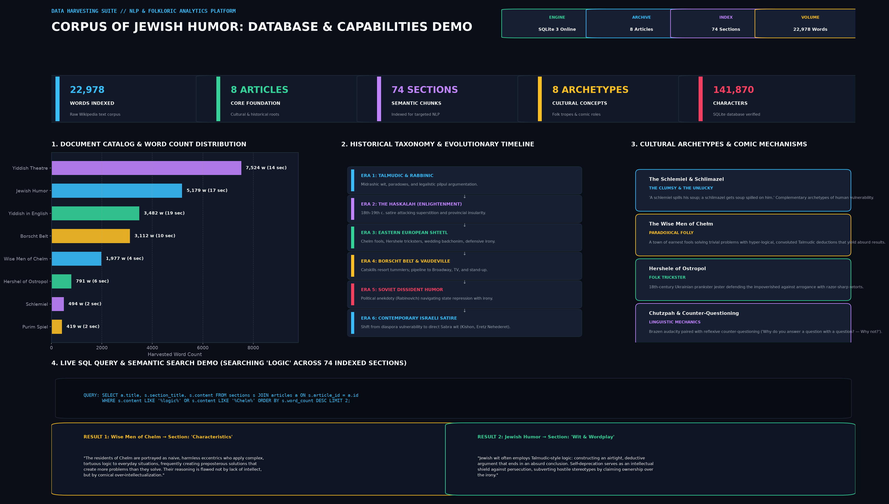

# Corpus of Jewish Humor 🎭 (v0.4.0)
[](https://huggingface.co/datasets/abr00kx/jewish-humor-corpus)
[](LICENSE)

> A comprehensive computational linguistics, folklore research, and machine learning dataset suite for Jewish humor across Ashkenazi, Sephardic, Talmudic, Soviet, and Modern traditions.



---

## What is Jewish Humor Corpus?

The **Corpus of Jewish Humor** is an open-source natural language processing suite and structured cultural dataset. It pairs historical encyclopedic literature with a **curated registry of 100+ primary jokes**, bilingual orthography, semantic vector search, and computational humor analytics.

### Key Capabilities

1. **Dual-Mode Search Engine:** SQLite **FTS5 (BM25 keyword search)** alongside a **Dense Subword Vector Space Model (Cosine similarity)** and Hybrid Reciprocal Fusion.
2. **Primary Joke Registry:** 100 structured jokes across 12 traditions with setup, punchline, comedic analysis, and original scripts (Yiddish Hebrew script, YIVO romanization, Ladino, Cyrillic).
3. **Humor-NLP Analytics:** Automated calculation of **Sentiment Inversion ($\Delta P$)**, Incongruity Index, Dialogue-to-Narrative ratios, and Yiddish/Ladino loanword density.
4. **Machine Learning & Hugging Face Ready:** Direct export to **Apache Parquet** and **Hugging Face instruction-tuning JSONL** for LLM fine-tuning and reasoning benchmarks.
5. **Zero-Dependency Web Portal:** Embedded local web server with live search and REST API.

---

## Dataset & Storage Metrics

- **Relational & Search Database:** SQLite 3 with FTS5 virtual tables (`data/jewish_humor.db`)
- **Primary Joke Holdings:** **100 structured primary jokes** across 12 traditions with fine-grained setup/punchline segmentation.
- **Corpus Text Holdings:** **56,872 words** across **21 foundational texts** and **196 categorized sections** (355k+ characters).
- **Archetype Catalog:** 20 pre-indexed cultural archetypes spanning folklore, mysticism, Talmudic debate, and satire.

---

## Quickstart

### 0. Load Directly via Hugging Face `datasets`
```python
from datasets import load_dataset

# Load the primary joke benchmark dataset
dataset = load_dataset("abr00kx/jewish-humor-corpus")
print(dataset["train"][0])
```

### Installation
Clone the repository and install as an editable package (provides the `jhc` command):
```bash
git clone https://github.com/ajejfiejof/jewish-humor-corpus.git
cd jewish-humor-corpus
pip install -e .
```

### Run the Interactive Terminal Demo
```bash
python3 demo.py
```

### Run the Automated Test Suite
```bash
python3 -m unittest discover tests
```

---

## CLI & Research Toolkit

The `cli.py` (or `jhc`) command provides full access to the corpus:

### 1. Dual-Mode & Semantic Search (`search`)
Supports keyword matching (FTS5 BM25), conceptual semantic matching (Vector Cosine), or combined Hybrid search:
```bash
# Hybrid Search (Default: BM25 + Vector Fusion)
python3 cli.py search "golem" --mode hybrid

# Conceptual Semantic Search (finds thematic matches even without exact words)
python3 cli.py search "financial anxiety" --mode semantic
python3 cli.py search "cynical resignation" --mode semantic

# Pure Keyword Search (with prefix wildcards)
python3 cli.py search "soup*" --mode fts
```

### 2. Primary Joke Registry (`jokes`)
Explore the 100-joke primary registry with original language scripts and comedic mechanics:
```bash
# Browse all jokes
python3 cli.py jokes

# Filter by tradition
python3 cli.py jokes --tradition Sephardic
python3 cli.py jokes --tradition Soviet
python3 cli.py jokes --tradition Talmudic
python3 cli.py jokes --tradition Chełm

# Search inside setups, punchlines, and analyses
python3 cli.py jokes --search "donkey"
```

### 3. Computational Humor & Stylometry (`analyze`)
Evaluates linguistic traits, dialectic counter-questioning, and humor mechanics across the corpus:
```bash
python3 cli.py analyze
```
Outputs:
- **Yiddish & Ladino Loanword Density:** Frequency per 1,000 words.
- **Rhetorical Question Rate:** Quantifies Talmudic dialectic syntax (*peaks at 12.2 / 1k words*).
- **Sentiment Inversion Index ($\Delta P$):** Quantifies emotional shift between setup and punchline.
- **Incongruity & Paradox Index:** Measures premise subversion across folk traditions (*average 0.876 / 1.000*).
- **Dialogue Ratio:** Tracks direct speech proportion across eras.

### 4. Machine Learning & Dataset Exports (`export`)
Export the corpus directly into standard machine learning and data science formats:
```bash
# Hugging Face Instruction-Tuning Dataset (JSONL)
python3 cli.py export --format hf_instruct --output jewish_humor_instruct.jsonl

# Apache Parquet Table (for Pandas, DuckDB, Polars)
python3 cli.py export --format parquet --output jewish_humor_jokes.parquet

# Full Corpus Markdown Research Dossier
python3 cli.py export --format markdown --output corpus_dossier.md

# Standard JSON & CSV
python3 cli.py export --format json --output corpus.json
python3 cli.py export --format csv --output corpus.csv
```

### 5. Automated MediaWiki Harvester (`harvest`)
Ingests any new Wikipedia article into both the relational schema and the FTS5 search index in real time:
```bash
python3 cli.py harvest "Sholem Aleichem"
python3 cli.py harvest "Judaeo-Spanish"
```

### 6. Embedded Web Portal & REST API (`serve`)
Launches a zero-dependency local web explorer at `http://localhost:8000`:
```bash
python3 cli.py serve --port 8000
```
**API Endpoints:**
- `GET /api/search?q=golem`: FTS5 BM25 search results with highlighted snippets.
- `GET /api/jokes`: 100 primary jokes with setup, punchline, and original script.
- `GET /api/catalog`: Complete document list with word and section counts.
- `GET /api/archetypes`: 20 cultural archetypes and definitions.

---

## Corpus Taxonomy: The 6 Knowledge Domains

1. **Folk Anthologies & Primary Jokes:** Chełm folly cycles, Hershele of Ostropol trickster tales, Sigmund Freud's *Jokes and Their Relation to the Unconscious*, and Soviet *Rabinovich* dissident anekdoty.
2. **Mythic Archetypes & Folklore:** The Golem of Prague, The Dybbuk, Tzadikim Nistarim (36 Hidden Righteous), Elijah the Prophet, Luftmensch, and Gimpel the Fool.
3. **Talmudic Dialectics & Rabbinic Parables:** The Oven of Akhnai (*Lo BaShamayim Hi*), Pilpul parodies, and rabbinic counter-questioning.
4. **Sephardic & Judeo-Spanish (Ladino) Lore:** Djohá (Djudha) Mediterranean trickster tales, Ladino refranes (proverbs), and Matilda Koen-Sarano collections.
5. **Classic Yiddish & Hebrew Satirists:** Mendele Mocher Sforim (*The Travels of Benjamin the Third*), Sholem Aleichem, and Ephraim Kishon (*The Blaumilch Canal*).
6. **American Stand-Up & Borscht Belt Pipeline:** Catskills tummlers (Henny Youngman), Lenny Bruce's sociolinguistic satire, and the transition into *Seinfeld* and *Curb Your Enthusiasm*.

---

## License

This project is licensed under the [MIT License](LICENSE).
